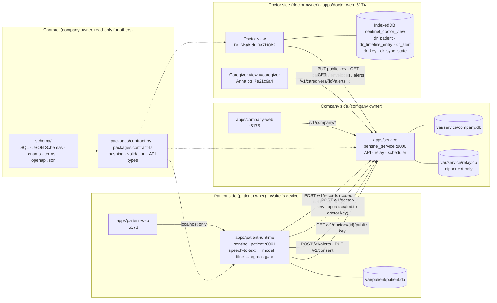
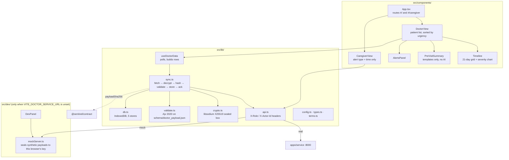
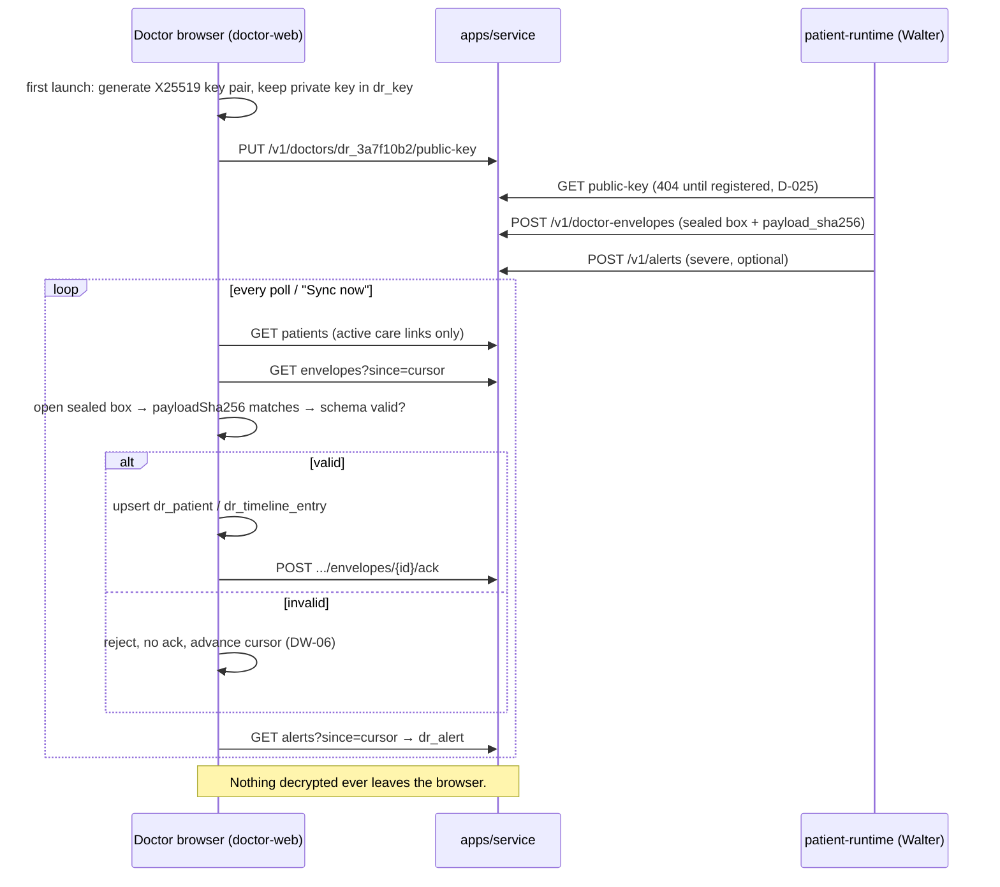

# Architecture: apps/doctor-web

How the doctor and caregiver views fit into the SafeSignal repo. Folder names, ports and calls match `README.md`, `CODEOWNERS`, `schema/` and `docs/briefs/doctor-web.md`. If this file disagrees with them, they win.

## 1. Whole system (repo layout)

Privacy line: the service only ever holds ciphertext for the doctor. The private key lives in `dr_key` in the doctor's browser, so only that browser can read check-ins.

## 2. Inside apps/doctor-web

## 3. One envelope, end to end

## 4. Component branches

Work is pushed as a stack of branches, one per component. Each branch builds on the one before it, so merge them in this order:

| # | Branch | Contents |
|---|---|---|
| 1 | `doctor/scaffold` | Vite/React/TS/Tailwind setup, configs, `check-secrets.sh`, app docs (this file, logs, CLAUDE.md) |
| 2 | `doctor/sync-engine` | `src/lib/*`, `src/dev/mockServer.ts`, `scripts/parity.ts` |
| 3 | `doctor/doctor-view` | `DoctorView`, `Timeline`, `PreVisitSummary`, `AlertsPanel`, `DevPanel`, doctor route |
| 4 | `doctor/caregiver-view` | `CaregiverView`, `#/caregiver` route |

Run `scripts/check_ownership.sh` before every push. Never push to `main` directly.
